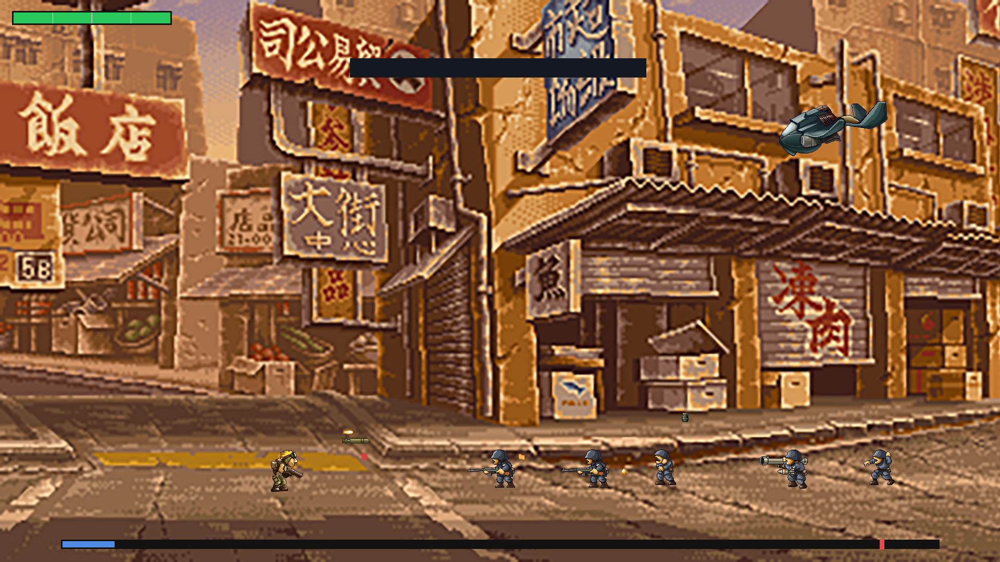

# Metal-Slug

使用 C++ 和 EasyX 写的合金弹头小游戏（Windows 平台）。



---

## 一、编译运行（Windows）

### 环境要求
- Visual Studio 2019 / 2022（MSVC，C++14 及以上）
- [EasyX](https://easyx.cn/) 图形库（安装后头文件在 `EasyX\include`，库文件在 `EasyX\lib\x64`）

### 步骤
1. 用 VS 新建「控制台应用程序」（x64）。
2. 把本目录下的 `HeJinDanTou.cpp`、`EasyXPng.h`、`toggle.h` 加入工程。
3. 项目属性 → C/C++ → 常规 → **附加包含目录** 加上 EasyX 的 `include` 目录；
   链接器 → 常规 → **附加库目录** 加上 EasyX 的 `lib\x64`；
   链接器 → 输入 → **附加依赖项** 加上 `EasyXa.lib`（或 `EasyXw.lib`）。
4. 字符集选 **Unicode**（代码使用 `TCHAR` / `_T()` / `swprintf_s`）。
   两种字符集都编得过，`run_checks.sh` 会分别用 Unicode 和 ANSI 各检一次。
5. 编译。把工程根目录设为**工作目录**（素材是相对路径加载的）。
6. 直接运行 `HeJinDanTou.exe` 即可。

> 提示：调试时把工作目录设成工程根目录，否则会提示找不到 `background1.png` 等素材。

### 或者用 CMake

仓库里带了一份 `CMakeLists.txt`（原来的 VS 工程文件没有提交进仓库）：

```bash
mkdir build && cd build
cmake .. -G "Visual Studio 17 2022" -A x64 -DEASYX_ROOT=C:/EasyX
cmake --build . --config Release
```

可执行文件会直接输出到源码根目录（和素材放在一起），因为游戏按相对路径加载素材。

### 素材目录
运行时需要以下相对路径，缺一不可：

```
background1.png background2.png background3.png bk4.png
menu.png putong.png wujing.png select.png round1.png round2.png round3.png
zidan.png dazidan.png enemyzidan.png liudan.png boom.png E.png
tong.png potong.png shadai.png myFeiji.png win.png fail.png Market.mp3
zhujue/body/  zhujue/foot/  qiang/  dao/  liudan/  shouliudan/
feiji/  die/  die2/  boss/  oldman/
```

---

## 二、操作

| 按键 | 功能 |
| --- | --- |
| `空格` | 菜单：切换模式 / 选关；游戏中：机上投弹 |
| `回车` | 确认、进入下一关 |
| `ESC` | 返回上一层 |
| `W A S D` / 方向键 | 移动、跳跃、趴下；机上为上下左右飞行 |
| 鼠标 | 瞄准（子弹跟随鼠标方向） |
| 鼠标左键 | 射击（按住连发） |
| `1` / `2` | 切换步枪 / 炮台 |
| `E` | 交互（上下飞机、解救老人）；解救完成后再按一次继续 |

开火时人物和武器朝向鼠标；飞机同样会受伤。Boss 挥刀前会在地面标出范围，
可以跳跃或后退躲避。每累计击杀 10 名敌人，恢复 12 点生命和 12 发炮弹（不超过上限）。

---

## 三、无头校验（任意平台，不需要 Windows）

`tools/` 下有一套 EasyX 桩头文件，可以在 Mac / Linux 上把游戏编译成无头程序，
用 AddressSanitizer + UndefinedBehaviorSanitizer 跑完整流程：

```bash
./tools/run_checks.sh                        # 语法检查 + 全流程测试
METAL_SLUG_SOAK=36000 ./tools/run_checks.sh   # 10 分钟长时压测
```

它会验证：菜单 → 选关 → 战斗 → Boss 战 → 解救人质 → 通关 → 失败 → 无尽模式，
并检查实体数量是否有界、坐标是否出现 NaN、有无越界读写与未定义行为。

最后还有一组**专项回归**，逐条覆盖上面表格里每个修复点
（刀兵近战、掩体挡弹、命中优先级、敌机朝向、关卡差异、无尽模式循环、碰撞盒稳定性、
敌人不被掩体卡死、敌弹与手雷的掩体碰撞、过关清弹幕、各关兵种权重、素材缺失检测）。

第四轮新增：HUD 格式化、短提示覆盖、滚屏瞄准、飞机边界与朝向、ESC 返回、
波次容量。`tools/timing_test.cpp` 还会运行真实入口：桩时钟推进约 2 秒时，
应执行约 120 次逻辑更新，避免直接调用 `update()` 的测试绕过主循环计时问题。

第三轮历史结果：默认 3600 帧约 280 项检查、10 分钟 36000 帧长压测约 2400 项检查，均 0 失败。
脚本第 3 步只做实现细节的文本抽查（不作为通过条件），真正的行为验证全在第 2 步的断言里。

这些专项测试都做过**证伪验证**：把对应修复逐条改回坏行为，确认测试真的会失败
（而不是写了一个恒真的断言）。

### 离线目视检查（可选）

仓库 `docs/screenshots/` 里是这套管线渲染出来的真实画面（不是示意图，是用你的真实素材跑出来的）：

| 截图 | 说明 |
| --- | --- |
| `04_第一关战斗.png` | 第一关：敌人全部面向玩家，敌机横飞，第一关无掩体 |
| `05_Boss战.png` | Boss 战：Boss 持刀向左（面向玩家） |
| `08_第二关掩体.png` | 第二关：油桶与沙袋作为掩体，子弹会被挡住 |


`tools/convert_textures.py` 会把真实素材转成桩头文件能读的原始格式，
`tools/render_shot.cpp` 就能把游戏画面无头渲染出来（不需要 Windows）：

```bash
python3 tools/convert_textures.py
clang++ -std=c++14 -O2 -DUNICODE -D_UNICODE -I tools/easyx_stub \
        tools/render_shot.cpp -o /tmp/ms_shot
/tmp/ms_shot && python3 tools/raw_to_png.py      # 输出 /tmp/ms_shot_*.png
```

| 文件 | 内容 |
| --- | --- |
| `tools/easyx_stub/` | EasyX / Windows API 的最小桩实现 |
| `tools/headless_test.cpp` | 无头全流程测试台 |
| `tools/timing_test.cpp` | 真实主循环计时回归 |
| `tools/visual_test.cpp` | 朝向像素校验、飞机受伤、Boss 命中与躲避、解救继续、跳跃与补给回归 |
| `tools/render_shot.cpp` | 无头渲染截图 |
| `tools/convert_textures.py` | 素材 → 桩可读格式 |
| `tools/raw_to_png.py` | 帧缓冲 → PNG |

---

## 四、重构说明

代码仍是**单文件**（`HeJinDanTou.cpp`），保持 Windows + EasyX 平台不变。

### 结构
- 全局可变状态全部收敛进 `Game` 结构体，只保留只读资源表 `g_assets`。
- 5 个近乎重复的子弹类 → 1 个 `Bullet` + `BulletKind`。
- 5 类敌人 → 1 个 `Enemy` + `EnemyKind` + 配置表 `kEnemySpec`。
- 主角绘制的 64 个分支 → 表驱动（4 姿态 × 2 武器 × 2 层级）。
- 15 份重复的碰撞代码 → 1 套统一碰撞管线。
- 3 份重复的 Boss 逻辑 → 1 套 Boss 状态机。
- 通用参数集中在 `namespace Cfg`，兵种和关卡参数分别由配置表管理。

### 修复的原版缺陷
| # | 问题 |
| --- | --- |
| B1 | `range-for` 中 `erase` 当前迭代器 —— 迭代器失效，属未定义行为 |
| B2 | 子弹出界/命中后永不回收 —— 无尽模式下内存无限增长 |
| B3 | 输入包在 `_kbhit()` 里 —— 「按住」键位经常按不下去 |
| B4 | 渲染过程中调用 `rand()` —— 敌人每帧随机取帧，画面闪烁 |
| B5 | 敌人士兵朝向画反了 —— 永远背对玩家 |
| B6 | 子弹瞄准角在朝左时被整体取反 —— 子弹往反方向飞 |
| B7 | `putToggleImagePng` 镜像索引用错宽高 —— 贴边时越界读 |
| B8 | 缺少无敌帧 —— 被一发手雷直接秒杀 |
| B9 | 帧率被 `Sleep(100)` 锁死在 10 FPS |

### 复核阶段修复的问题（第二轮）
独立复核发现并已修复：

| # | 问题 | 修法 |
| --- | --- | --- |
| A1 | **刀兵完全失效** —— 枪兵在 300px 停下开火，刀兵近战判定却是 62px，两个阈值互斥，永远打不到人 | `EnemySpec` 增加 `stopRange`，刀兵单独设 30px；近战判定放到挥砍动画中段结算 |
| A2 | 沙袋不再阻挡子弹 —— 不可破坏障碍被整体跳过 | 沙袋与油桶一样吃掉子弹，只是不扣血 |
| A3 | 命中优先级与原版相反 —— 子弹穿桶打死敌人 | 障碍判定提前到敌人判定之前（同原版 `checkZhangAiWu`） |
| A4 | 无尽模式最多只出现 1 场 Boss —— Boss 死后状态卡在 `BSS_DEAD`，再也不回 `BSS_NONE` | 无尽模式用 `nextBossWave` 计数触发；救完人后重置 Boss 状态 |
| A5 | 敌机越过玩家后被镜像成朝右（像掉头） | 敌机朝向改由速度 `vx` 决定，不再按「朝玩家」推导 |
| A6 | 无尽模式救出老人显示「任务失败」 | 无尽模式救完人回到 `PH_PLAY` 进入下一轮，不再进 `PH_OVER` |
| A7 | 三关共用同一套随机权重，且第一关也摆满油桶 | `LevelConfig` 增加每关的障碍数量、敌人权重与开局固定编队 |
| A8 | 失败后回车直接回主菜单 | 普通模式回选关界面，无尽模式回主菜单（同原版） |
| B1 | 敌人避障用的是主角的碰撞盒 | 增加 `enemyBoxAt`，各用各的盒子（注：掩体挡路这件事在第三轮被整体取消，见 F1） |
| B2 | 主角碰撞盒随开火跳变（贴图切重武器导致尺寸突变） | 改用固定常量 `PLAYER_HIT_W/H`，不再从会变的贴图推导 |
| B3 | 敌弹与手雷完全无视障碍 | 敌弹同样做掩体碰撞；手雷撞到掩体直接消失（同原版） |
| B4 | 过关画面上残留定格的弹幕 | 进入过关状态时清空子弹 |
| B6 | 素材加载失败没有任何提示 | `loadimage` 后校验宽高，缺失的素材会打印出来 |

### 复核阶段修复的问题（第三轮）

第二轮复核判定为 FAIL，列出 F1–F11，逐条修复如下：

| # | 问题 | 修法 |
| --- | --- | --- |
| F1 | **敌人被掩体卡死** —— 第二轮为了修 A1 让敌人与掩体做碰撞，结果油桶挡路的关卡里刀兵永远走不到玩家面前，A1 等于白修 | 改为「掩体只挡子弹和主角」：敌人移动不再与掩体碰撞。原版用 `checkIsDangZhu()` 把敌人的整个 `update()` 冻结在障碍前（连开火都停了），本重构不继承这个行为 |
| F2 | 过关清弹只做了一半 —— `bullets.clear()` 写在 `updatePlayer()` 里，但同一帧 `updateEnemies()` 还会补出新子弹，下一帧进入 `PH_CLEAR` 直接 return，子弹被冻在过关画面上 | 清弹挪到 `updatePlay()` 的实体更新之后统一做 |
| F3 | 无尽模式第二轮起掩体全失 —— `endlessCycle()` 只 `obstacles.clear()` 没有重铺 | 抽出 `spawnObstacles()`，换轮时重铺；掩体按关卡宽度均匀分布，不再摆到关卡外 |
| F4 | `bossCount` 跨轮 / 跨模式泄漏（`resetRound()` 从不重置） | `resetRound()` 里归零，并连带清掉 toast / 屏震 / 朝向等残留状态 |
| F5 | A3 用例没有鉴别力 —— 敌人站在沙袋右侧且两者不重叠，改坏判定顺序也测不出来 | 敌人移到 `x = 580`，身体与沙袋重叠，两种判定顺序才会得到不同结果 |
| F6 | 「三关权重不同」只有结论没有断言 | 抽样 500 波统计兵种占比与 `kLevel[i].weight` 比对，并直接断言三关权重表互不相同 |
| F7 | 「敌人用敌人自己的盒」没有断言 | 改成行为断言：油桶挡在中间时刀兵仍要能贴到玩家面前，同时主角确实被掩体挡住 |
| F8 | 「敌弹 / 手雷做掩体碰撞」没有断言 | 新增专项：敌弹被沙袋挡住后玩家不掉血；手雷撞沙袋后哑掉、不爆炸 |
| F9 | 「过关清空子弹」没有断言 | 新增专项，并特意覆盖「敌人与救人同帧开火」的边界 |
| F10 | 素材校验在桩下恒为 0 —— 桩在文件缺失时回退 64×64 噪声，`getwidth() > 0` 永远进不了缺失分支 | 桩改为按真实 EasyX 行为返回 0×0 空图，并新增用例断言「缺失素材被计数」 |
| F11 | `run_checks.sh` 第 3 步只是 grep 字符串匹配，却当成通过条件 | 降级为「实现细节提示」，不再阻断；行为验证全部由第 2 步的断言承担 |

同时顺手修掉的两个真实缺陷：

- **手雷撞掩体的分支形同虚设**：手雷落地判定排在掩体判定前面，而掩体高度带几乎全在地面线以下，
  高速下落的手雷会一步跨过去 —— 掩体永远挡不住它。改成用「本帧走过的区间」做扫掠判定，
  并把掩体判定排到落地判定之前。
- **`printAssetPath()` 的缓冲区没有在字符串末尾截断**，会把栈上的垃圾字符一起打印出来。

另外删掉了冗余的 `mode` 字段：玩法路径早已统一用 `endless` 判断模式，
两个标志并存只会带来失同步。

### 复核阶段修复的问题（第四轮）

按本文档的操作、60 FPS 和实体数量有界要求继续复核，发现并修复：

| 问题 | 修法 |
| --- | --- |
| 主循环累计秒数，却与 `1000 / 60` 毫秒阈值比较，逻辑实际约 16.7 秒才更新一次 | 步长统一为 `1 / 60` 秒，并增加真实入口测试 |
| `tsprintf()` 把 `va_list` 当普通参数传给格式化函数，HUD 血量、分数等数字错误 | 使用 `vswprintf_s` / `vsprintf_s`，补充桩实现与行为断言 |
| 新提示比旧提示短时，末尾残留旧文字 | 在实际复制结束处写入终止符，覆盖空提示场景 |
| 鼠标使用屏幕坐标、枪口使用世界坐标，滚屏后瞄准方向错误 | 鼠标横坐标加上相机偏移后计算角度；测试台与截图脚本按屏幕坐标注入鼠标 |
| 飞机只限制屏幕范围，会越出关卡；左移也不改变朝向 | 同时限制世界边界，并由移动方向更新朝向 |
| 文档写明 ESC 返回上一层，但战斗、过关和结束界面没有处理 | 普通模式返回选关，无尽模式返回主菜单；结束提示也按模式显示 |
| 一波可生成多名敌人，导致超过关卡上限；无尽模式上限随波次无限增加 | 每波受剩余名额约束，无尽模式在场敌人最多 64 名 |

上述新增行为回归已在修复前观察到失败。全流程测试固定随机种子，便于复现问题。
第四轮验证：默认 3600 帧全流程在 ASan + UBSan 下完成 296 项检查、0 失败；
真实入口 120 个渲染帧执行 119 次逻辑更新；Unicode / ANSI 语法检查零警告，
ANSI 新增专项与入口测试也在 ASan + UBSan 下通过。本轮未重跑 36000 帧长压测。
无头验证不能替代 Windows + 真实 EasyX 环境下的编译、音频与目视验收。

### 玩法反馈修复与优化（第五轮）

本轮根据实际游玩反馈重新核对了原始素材和真实绘制结果：

- **小兵与武器朝向**：四种地面小兵原图均朝左，纠正错误的素材方向配置；
  火箭弹弹头也按其朝左的原图决定镜像。开火时人物跟随鼠标转向，
  枪口采用开火贴图尺寸，修复近距离鼠标落在身体内时子弹反向飞出的情况。
- **飞机可受伤**：取消机上无敌，使用飞机碰撞盒；敌方步枪与火箭会瞄准空中目标，
  敌机炸弹可以在空中命中飞机。保留受击无敌帧和闪白反馈。
- **Boss 可以追击与命中**：Boss 向玩家靠近，向左右两侧转身攻击；
  挥刀有地面范围预警和刀光，刀光与伤害共用范围并在动画中段结算。
  横斩可通过及时跳跃躲避，低空飞机仍会被命中，高空可以避开刀刃。
- **解救后可继续**：人质与飞机靠得很近时优先救人；获救后显示有底色的完成提示，
  再按 E、回车或空格进入下一关，第三关进入胜利画面，无尽模式继续下一轮。
- **第三关白色天空**：加载时把原图残留的紫红底色区域替换为白色，保留建筑颜色。
- **操作与节奏**：跳跃滞空从约 2 秒缩短到约 0.8 秒；跳跃按下触发，落地不会因长按再次起跳；
  飞机斜向移动不再额外加速，同时按左右键也不会原地跑步。敌人伤害提高，配合十击杀回血补弹。
- **动画与提示**：死亡、爆炸按 10 FPS 播放，避免五帧死亡动画在 0.08 秒内消失；
  显示持续的任务目标，字体统一为 24px，并调整底部帮助的位置避免裁切。
- **成功／失败徽章**：使用 PNG alpha 透明绘制，去除矩形白框与黑底，保留徽章和文字。
- **退出停止音乐**：窗口关闭后结束主循环，停止并关闭 MCI 音乐；同时注册退出清理，覆盖窗口关闭直接触发程序退出的路径。
- **Windows 构建**：数字键使用标准字符键码；CMake 默认选择 `EasyXw` 时同步定义 Unicode 宏。

新增像素回归逐帧比较四类小兵在玩家左右两侧的实际绘制结果，
不再只检查 `faceRight` 标志。真实素材缓存存在时还会校验第三关天空采样；
无缓存时会明确跳过该采样，其余行为与像素回归仍可运行。

截图已更新，并补充 `09_第三关白色天空.png`、`10_Boss向左挥刀.png`、
`11_Boss向右挥刀.png` 和 `12_解救完成.png`。
离线桩目前不绘制字体，截图用于检查素材、朝向、刀光和颜色；文字需在 Windows 上验收。

第五轮最终验证：默认 3600 帧全流程 299 项检查、视觉与战斗专项 175 项检查均为 0 失败，
ASan + UBSan 无异常；真实入口约 2 秒执行 119 次逻辑更新；Unicode / ANSI 语法检查零警告，
ANSI 专项也通过。本轮未执行 Windows 原生构建，也未重跑 36000 帧长压测。

### 玩法与表现调整
- 逻辑改为 **60 FPS 固定步长**（逻辑与渲染解耦），所有速度改为 px/s。
- 相机跟随主角，关卡可真正横向推进。
- 炮台有弹药上限（60 发），HUD 显示当前武器与余弹。
- 受击无敌帧 + 击退 + 命中闪白 + 粒子 + 屏震。
- Boss 会真的挥刀攻击，带血条、半血狂暴阶段与死亡动画。
- HUD：血条、武器与弹药、分数、击杀、波次、关卡进度条、Boss 血条、提示气泡。
- 敌机改为真的横向飞越；手雷落地会爆炸。
- 第二关开局主角在飞机上，机上可射击、投弹，也会受到敌方攻击。

### 渲染层优化（`EasyXPng.h` / `toggle.h`）
- 修正镜像索引越界（原来贴图贴近屏幕边缘会读越界）。
- 逐像素混合的 `/255` 换成乘法位移，省掉整数除法。
- 全透明 / 全不透明像素走快速路径。
- 新增命中闪白（`putimagePngFlash` / `putToggleImagePngFlash`）。
- `toggle.h` 不再重复实现一份混合代码，改为复用 `EasyXPng.h`。
